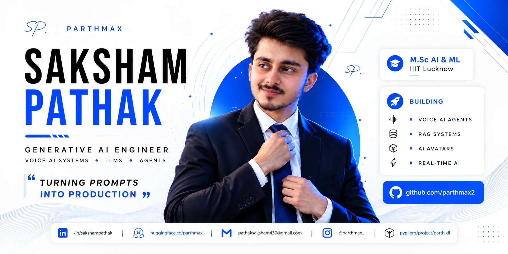
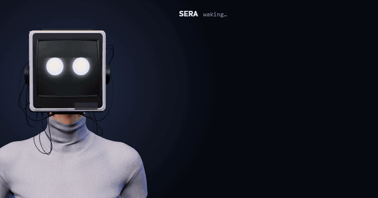

 

---
<table>
<tr>

<td width="58%" valign="top">

## About Me

I'm **Saksham Pathak**, a Generative AI Engineer and M.Sc. AI & ML graduate of IIIT Lucknow, building intelligent systems that can listen, reason, retrieve knowledge, and take action.

My work spans **Voice AI, Agentic Systems, RAG Pipelines, Fine-Tuning, and LLM Testing**, with a strong interest in real-time AI experiences that feel natural and human.

Currently, I'm exploring:

* 🎙️ Barge-in Voice Agents & Custom VAD
* 🧠 Agentic Workflows with Google ADK, LangGraph & MCP
* 🛡️ Agent Reliability: Failure Recovery, Guardrails & PII Redaction
* 🧪 Deterministic Testing & Evaluation for LLM Apps
* 🎭 Real-Time 3D Conversational Avatars

I enjoy turning ambitious AI ideas into practical systems that people can interact with, trust, and use every day.

</td>

<td width="42%" align="center">

  

</td>

</tr>
</table>

---

## ARSENAL

| Domain | Stack |
|:--|:--|
| **Voice AI** | Whisper · Deepgram · WebRTC · Custom VAD · STT / TTS · Twilio |
| **Agents** | Google ADK · LangGraph · LangChain · AutoGen · MCP · Tool Calling |
| **LLMs & Training** | PyTorch · Transformers · LoRA · PEFT · Gemini · OpenAI · Claude · Llama |
| **RAG & Vector** | FAISS · ChromaDB · Pinecone · Hybrid Search · Reranking |
| **Eval & Safety** | ghostrun · LLM-as-a-Judge · Ragas · Guardrails · PII Redaction |
| **Infra** | FastAPI · WebSockets · Redis · MongoDB · Docker · GCP Cloud Run · Vercel |

---

## SYSTEMS

**`01` — ghostrun · Testing for LLM Apps**
pytest-native record/replay for LLM calls, semantic assertions via a local judge, and Bayesian prompt optimization. Offline, free, deterministic CI.
`Python` `pytest` `Ollama` ·  

**`02` — Saarthi AI · Commute-Planning Agent**
Autonomous Google ADK agent that sweeps future departure windows and fuses traffic, weather and local events into a transparent risk score, with persistent MongoDB MCP memory.
`Google ADK` `Gemini` `MongoDB MCP` `FastAPI` ·  

**`03` — Real-Time 3D Conversational Avatar**
Speech → LLM → TTS with barge-in, synchronized facial blendshapes and lip-sync.
`PyTorch` `WebRTC` `TTS` `Custom VAD` · 

**`04` — DocuMind AI · Document Intelligence**
RAG-based Q&A and summarization over PDFs with OCR, FAISS retrieval and an MCP server on Gemini.
`FastAPI` `FAISS` `Redis` `Gemini` ·  

**`05` — parth-dl · Open Source CLI**
Zero-dependency Instagram media downloader. No login, no API key. Published on PyPI.
`Python` `CLI` ·  

**`06` — 100 Best GenAI Projects 2025**
Curated 100+ high-impact open-source LLM, RAG & Agent projects.
`LLM` `RAG` `Agents` · 

---
## OPEN SOURCE

- **[GitHub Docs](https://github.com/github/docs/pull/45118)** — Merged PR #45118: fixed a duplicated word in image alt text for the Copilot access docs.

---

## STATS

&nbsp;

---

*"The goal isn't to build models. The goal is to build intelligence that matters."*

